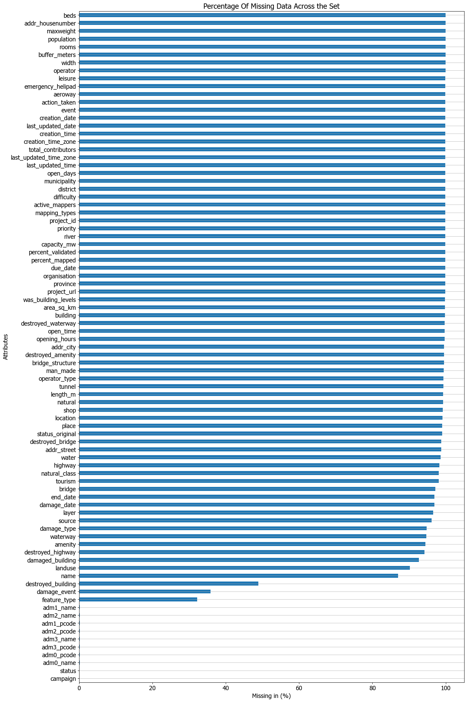
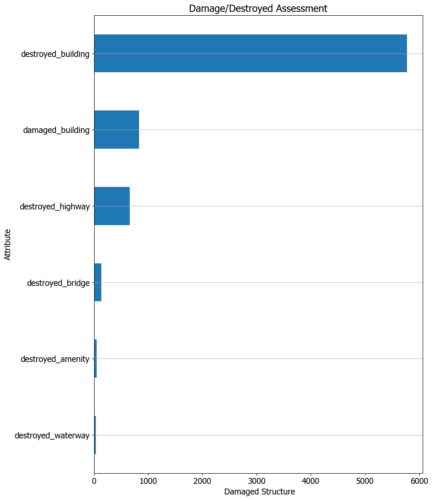
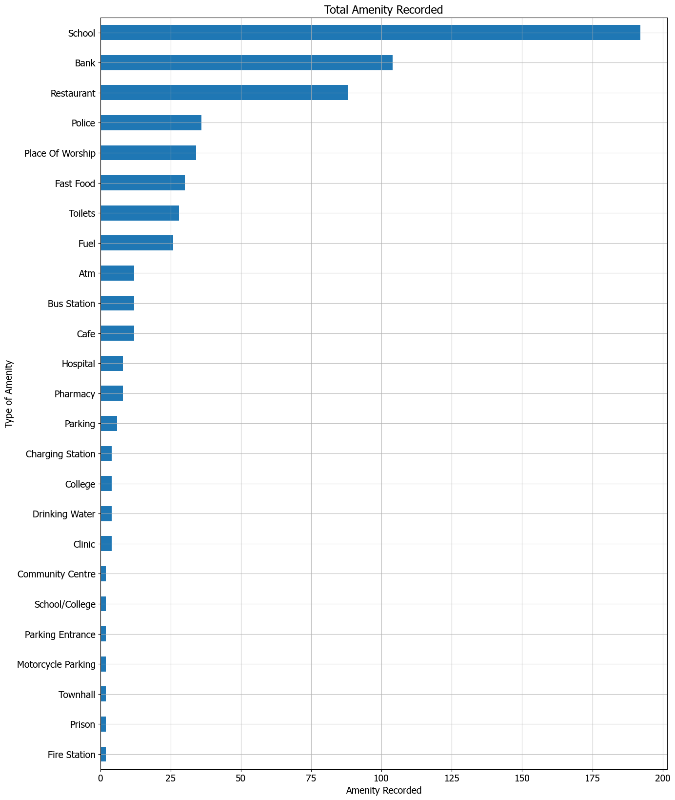

# Nepal Flood 2026: Humanitarian Geospatial Data Analysis

- [Nepal Flood 2026: Humanitarian Geospatial Data Analysis](#nepal-flood-2026-humanitarian-geospatial-data-analysis)
  - [Overview](#overview)
  - [Research Objectives](#research-objectives)
  - [Project Structure](#project-structure)
  - [Data Sources](#data-sources)
  - [Tools and Technologies](#tools-and-technologies)
    - [Installation](#installation)
    - [How to Run](#how-to-run)
  - [Data Processing](#data-processing)
  - [Exploratory Data Analysis](#exploratory-data-analysis)
    - [Data Constraint Graph](#data-constraint-graph)
    - [Infrastructure Damage/Destroyed Graph](#infrastructure-damagedestroyed-graph)
  - [Amenities Recorded](#amenities-recorded)
  - [Key Findings](#key-findings)
  - [Limitations and Challenges](#limitations-and-challenges)
  - [Conclusion](#conclusion)
  - [Future Work](#future-work)


## Overview

This project explores geospatial data associated with the 2026 Nepal floods, focusing on infrastructure, reported damage, and the availability and reliability of humanitarian mapping data.

The analysis uses geographic datasets published by the Humanitarian OpenStreetMap Team (HOT) through the Humanitarian Data Exchange (HDX). These datasets contain information about infrastructure and geographic features within the flood-affected region and its surrounding areas.

Using Python and libraries such as Pandas, NumPy, and Matplotlib, the project involves extracting, cleaning, transforming, and exploring the available data to identify patterns, assess data completeness, and understand the limitations of the available information.

## Research Objectives

Initially, the objective was to apply Machine Learning algorithms such as anomaly detection to analyze the integrity and to also predict which areas are affected the most and require urgent humanitarian support.

Due to limitation in the **dataset**, it was later reduced to exploratory analysis(EDA) to eventually extract and provide as much as relevant and important information as possible.

The project is organized into three main directories and three supporting files.

## Project Structure

Please refer below the structure of the project:

***Directories***

*NEPAL_FLOOD_DATA*/
Contains the original datasets downloaded from the source, including JSON and CSV files.

*TRANSFORMED_NEPAL_FLOOD_DATA*/
Contains datasets extracted from the original files and transformed into CSV format. It also includes an uncleaned master dataset created by combining the individual transformed files.

*CLEANED_NEPAL_FLOOD_DATA*/
Contains individually cleaned CSV datasets and the consolidated CLEAN_MASTER_DATA_FILE.csv.

**Supporting Files**

*DATA_EXTRACTOR*.py
Contains the dataset resource links and extraction logic used to download the individual datasets into NEPAL_FLOOD_DATA/.

*main*.ipynb
Handles data extraction, transformation, and the creation of the master dataset. It also contains the subsequent cleaning workflow.

*master_data_analysis*.ipynb
Contains the exploratory data analysis (EDA), including data summaries, statistical observations, and visualizations.

## Data Sources

The project uses datasets published by the Humanitarian OpenStreetMap Team (HOT) through the Humanitarian Data Exchange (HDX).

link : **https://data.humdata.org/dataset/hot_flood_npl**

Primary Dataset: Nepal Flood 2026 – Flood Affected Area, Bhote Koshi and Trishuli

The dataset provides geospatial information covering the flood-affected region and its surrounding areas in Nepal. It includes multiple geographic layers representing infrastructure, facilities, bridges, waterways, and other mapped features.

The data incorporates information from several sources, including:

1. OpenStreetMap (OSM)
2. Overture Maps
3. NAXA
4. Volunteer field reports

The available layers include infrastructure information, bridge damage assessments, education and health facilities, financial services, hydropower, and settlement information.

Important data consideration: The geographic area covered by the dataset includes the observed flood extent and a surrounding 200-metre buffer, as specified in the source dataset documentation. Therefore, the presence of a feature in the dataset does not necessarily mean that it was directly affected by flooding or sustained damage.

## Tools and Technologies

The project was developed using *Python and Jupyter Notebook*, with the following libraries:

| Tool / Library | Version | Purpose |
|---|---|---|
| Python | 3.11.9 | Core programming language |
| Pandas | 3.0.6 | Data manipulation, cleaning, and analysis |
| NumPy | 2.4.6 | Numerical operations and handling missing values |
| Matplotlib | 3.10.8 | Data visualizations and plotting |
| Requests | 2.34.2 | Downloading datasets from online sources |
| JSON | Standard Library | Reading and processing JSON-formatted data |
| OS | Standard Library | File and directory management |
| Glob | Standard Library | Locating and accessing files using patterns |

**Development Environment:** Jupyter Notebook

### Installation

```bash
git clone https://github.com/aamir-abbas224/nepal-flood-2026-geospatial-analysis.git
cd nepal-flood-2026-geospatial-analysis
pip install pandas numpy matplotlib requests jupyter
```

### How to Run

1. Open `main.ipynb` and run all cells. This downloads the raw data, creates the required folders, transforms and cleans the data, and builds the master dataset along with the individual cleaned files.
2. Open `master_data_analysis.ipynb` and run all cells to see the exploratory analysis and charts. 

## Data Processing

The data processing was carried out in multiple stages, starting with downloading the original datasets and eventually preparing them for analysis.

1.*Data Extraction*

The datasets were downloaded from the HDX source using Python's Requests library. The individual resource links were stored in DATA_EXTRACTOR.py, which handles downloading the files and saving them in the NEPAL_FLOOD_DATA/ folder.

2. *Data* *Transformation*

The downloaded files contained data in different formats, mainly JSON and CSV. The JSON files were processed to extract the relevant properties and geographic information, which were then converted into CSV files for easier handling and analysis.

3. *Data* *Cleaning*

The transformed CSV files were cleaned individually. This involved handling missing values, replacing certain placeholder entries, and removing columns that contained no useful data. The cleaned files were then saved in CLEANED_NEPAL_FLOOD_DATA/.

4. *Data* *Consolidation*

After cleaning the individual datasets, they were combined into a single master CSV file called CLEAN_MASTER_DATA_FILE.csv. This provided a consolidated dataset that could be used for further exploration and analysis

## Exploratory Data Analysis

After initial review and completion of master dataset. exploratory analysis was performed on it. The objective as stated was to apply ML techniques eventually but it was discovered that due to data constraints it won't be able to produce any meaningful results.

Below graphs provide the constraints as mentiond above: 

### Data Constraint Graph

Identifying inconsistencies, incomplete attributes, and limitations that could affect further analysis



The objective was shifted to explore the available data , understand the distribution of different kinds of infrastructure , examine the damaged/destroyed buildings, amenities and identify the gaps in the available information.

### Infrastructure Damage/Destroyed Graph

The graph shows the damaged/destroyed infrastructure affected by the floods.



## Amenities Recorded



## Key Findings

The exploratory analysis revealed several observations about the available datasets:

1. *Missing Information*: Several important attributes across the dataset contain a significant number of missing values, limiting the extent to conclude anything confidently.

2. *Infrastructure Records*: The dataset contains different types of mapped infrastructure and facilities, including bridges, buildings, schools, hospitals, financial services, and other amenities.

3. *Damage* *Reporting*: Although the dataset includes records marked as Standing, Damaged, and Destroyed, the availability of supporting information varies considerably across infrastructure types.

4. *Population* *Information*: Population data is extremely limited, making it unsuitable for estimating the number of people affected by the floods.

5. *Geographic Information*: The dataset covers the observed flood extent and its surrounding 200-metre buffer. Therefore, geographic inclusion alone cannot establish whether a feature was directly affected by flooding.

These observations highlight both the value of the available humanitarian mapping data and the limitations that need to be considered when interpreting its contents.

## Limitations and Challenges

1. Missing Values: Several data attributes had missing-value percentages of 90% or above. This created considerable limitations for both machine learning implementation and drawing meaningful conclusions from the available information.

2. Incomplete Information: Even where information was available, important corresponding attributes were often missing. This made it difficult to establish the condition of certain infrastructure features or draw reliable conclusions.

3. Limited Population Data: The available population information was insufficient to estimate how many people were affected by the floods, assess the broader impact on communities, or determine humanitarian support requirements.

4. Data Collection and Temporal Relevance: It was observed that some records and their associated information did not necessarily correspond to the August 26, 2026 flood event or its immediate aftermath. This raised questions about the temporal relevance and consistency of the available information.

These limitations affected the scope of the analysis and highlighted the importance of understanding data quality and context before drawing conclusions.

## Conclusion

This project provided an opportunity to work with real-world humanitarian geospatial data and understand the challenges involved in processing and analyzing it.

Although the initial objective was to explore machine learning applications, the available data did not provide sufficient information to support reliable predictive analysis. The focus was therefore shifted towards exploratory data analysis to examine the available infrastructure records, reported damage, and overall data quality.

The analysis highlighted the importance of data completeness, consistency, and relevance when working with datasets. While the available information provided some insight into infrastructure and reported damage within the mapped region, it was not sufficient to establish the full extent of flood impacts or determine humanitarian needs reliably.

Overall, the project helped establish a foundation for further analysis and demonstrated the importance of understanding the data before attempting to build predictive models.

## Future Work

The `coordinates` and `geometry_type` columns were left untouched. Working with them would require a Python library such as [Folium](https://python-visualization.github.io/folium/), which is a powerful geospatial visualizations library used to create interactive web maps .
